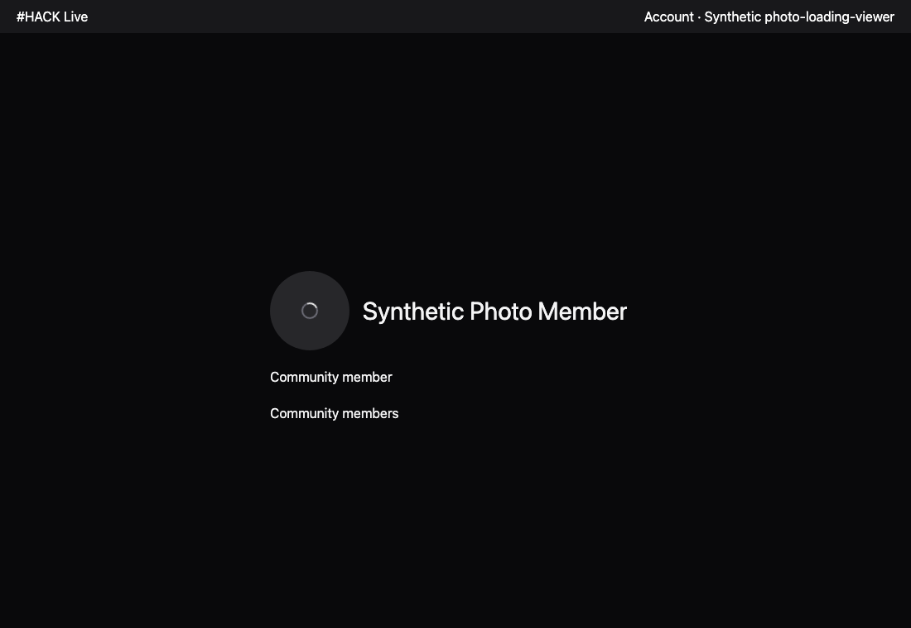
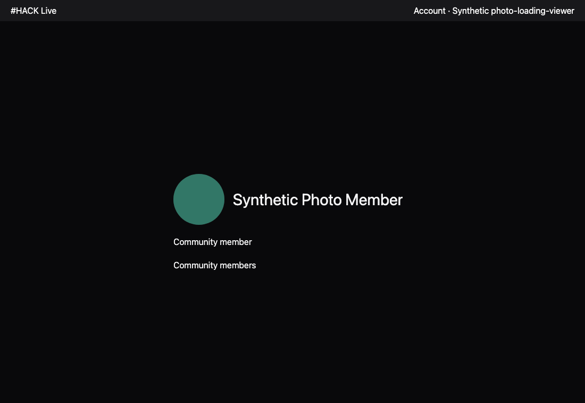
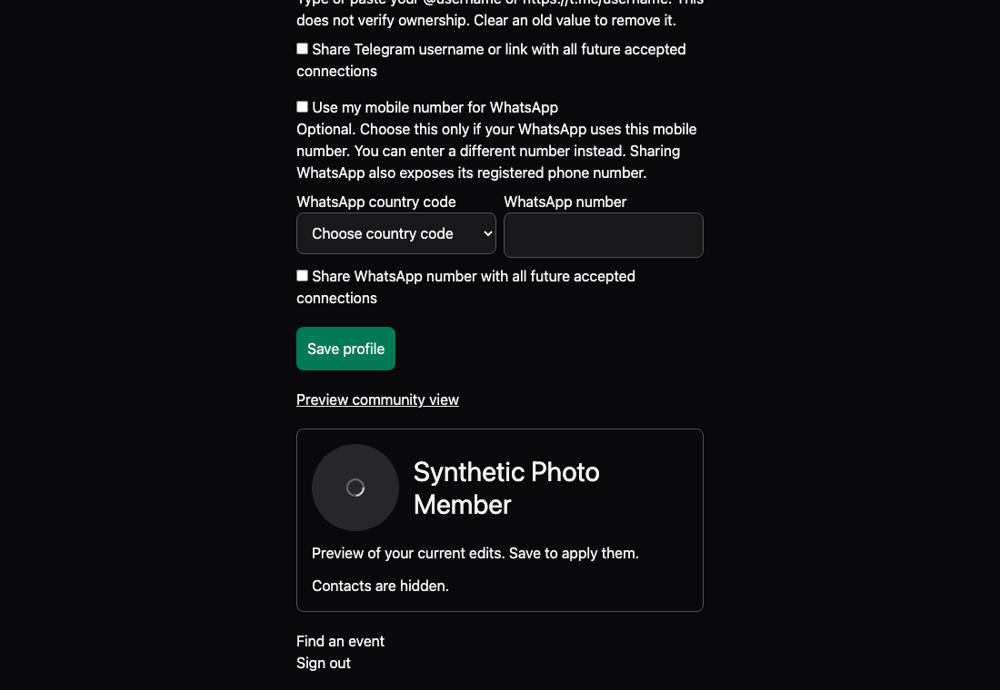
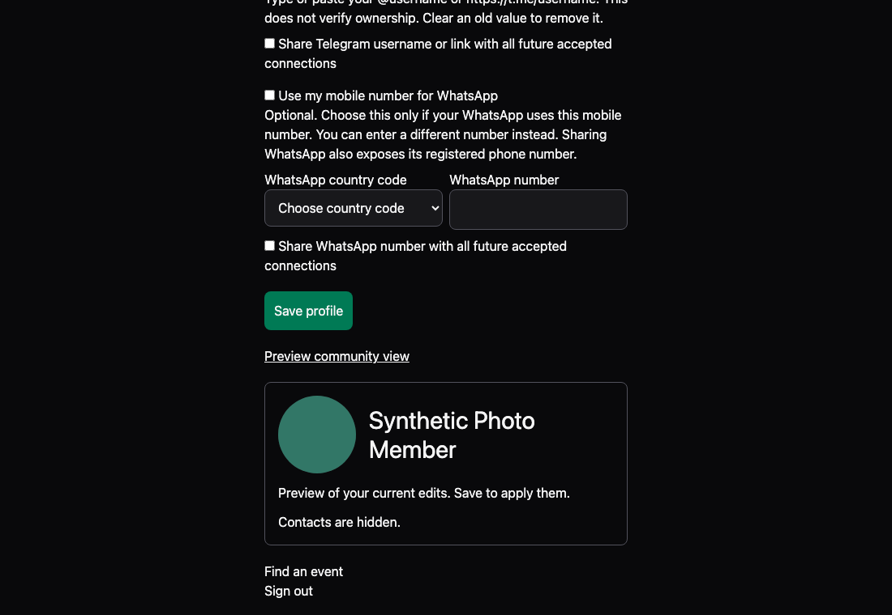

# PR2 profile photo loading checkpoint

Validated source and tests: `eccf1f488c5f7eabc63307a96429e3290b42ec55`, appended to final PR2 `8ff981026f64c6248f6cb9ec94e225b9b7246c24`. This evidence commit changes documentation and screenshots only. Schema/rules/server/auth-policy/cache changes: **none**.

The shared profile and owner community preview now reserve a 96 × 96 photo slot beside the name before member details or protected photo bytes resolve. An accessible loading status remains until image decode completes. No shared photo and HTTP/decode errors retain a neutral slot; URL replacement, sharing revocation, auth changes and unmount cancel stale work and revoke object URLs. Professional details omit the duplicate header photo. Existing bearer authorization, no-store requests, referrer policy and private-source projection remain intact. The exported `ProfilePhoto` accepts optional `size` for the complete slot (default 96; downstream badges use 56), plus optional `url` and parent `loading`.

## Validation

With Node 24.22.2 and Java 21.0.1:

- `npm run typecheck` passed.
- `npm run build` passed; the inherited bundle-size advisory remains.
- `npm run test:emulators` passed **51 tests**: 10 pure/image/parser, 19 identity API/rules, 5 protected photo API/rules, and 17 real Chromium journeys (the previous 47 plus four new photo regressions).
- The new regressions deterministically hold the real protected response and real image decode completion, assert the accessible loader is beside the name before release, and compare exact header/slot/name rectangles after success. They cover owner preview, no photo, HTTP error, invalid image decode, URL replacement, in-flight sharing revocation, abort signals, real auth sign-out/unmount and every created object URL being revoked.
- A separate paced run of `tests/browser/profile-photo-loading.spec.ts --grep 'shared header'` passed **1/1**, with `PROFILE_DEMO=true`. It calls real emulator auth, real save/read endpoints and real image decode; only response/decode delivery is held for deterministic review.

Full-run log: `.agents/memory/tasks/thr_y4xchxwxgs/full-suite-final.log`. Paced-run log: `.agents/memory/tasks/thr_y4xchxwxgs/photo-demo.log`. All four owned ports (3000/8080/9099/9150) were verified free before launch and after orderly app/emulator shutdown, then explicitly released to root/31. No runtime remains owned by this checkpoint.

The append-only test synchronization checkpoint `caaaf81735fb95251594f45367c904a8ad1ad929` also includes `3cde7dff9d47858f60f867819baf5cbfec344aa6`: photo-capable save assertions now match only the exact saved message and await their actual HTTP 200 response, and the loading journey waits for the completed sign-out screen before navigating to owner sign-in. The added accessible photo status exposed the old broad status locator; the second account navigation exposed an asynchronous sign-out race. These test-only fixes preserve all product bytes and frozen media from `eccf1f488c5f7eabc63307a96429e3290b42ec55`. The PR body records the final published-head CI outcome; no local services were restarted for this follow-up.

## Focused recording and stills

The additional focused clip is `pr2-profile-photo-loading.webm`, **15.92 seconds**, 1100 × 760, 25 fps. The [verified native recording](https://github.com/user-attachments/assets/2390f949-5b84-43b9-a094-e6b8776e8bac) was uploaded through the official GitHub CLI; the downloaded attachment matched the frozen bytes and SHA-256 below. The local video remains ignored/uncommitted. It supplements the three inherited PR2 profile assets. It is a continuous synthetic Chromium recording: shared loading/loaded around 2/5 seconds and owner preview loading/loaded around 11/14 seconds. Those actual decoded frames and all four screenshots were visually inspected; the name and slot stay fixed, and each loading/loaded state has a readable hold.

| Artifact | Bytes | SHA-256 |
| --- | ---: | --- |
| `docs/evidence/pr2-profile-photo-loading.webm` | 1,034,128 | `0bf226315aa225b55c1919555e8f1257fd426a2b56f1d8dae54a0a7af86a099d` |
| `docs/evidence/pr2-photo-loaded-owner.png` | 81,084 | `93eea49360782621fcbcdde64f70ef28a6a835d1099628f6f9f70f6644aa8f1f` |
| `docs/evidence/pr2-photo-loaded-shared.png` | 24,381 | `3a1cd4dc916caaabe123172d12cc69a240d103c139c36fae70d1580b4135935b` |
| `docs/evidence/pr2-photo-loading-owner.png` | 81,599 | `598b574e838270793757510e85e211ae35c719439ce39a2361b7e951567ad99c` |
| `docs/evidence/pr2-photo-loading-shared.png` | 24,936 | `a324a0596dd25df1d76af09d604e98f4e202e089e7e1994062af396a7e3839b6` |
